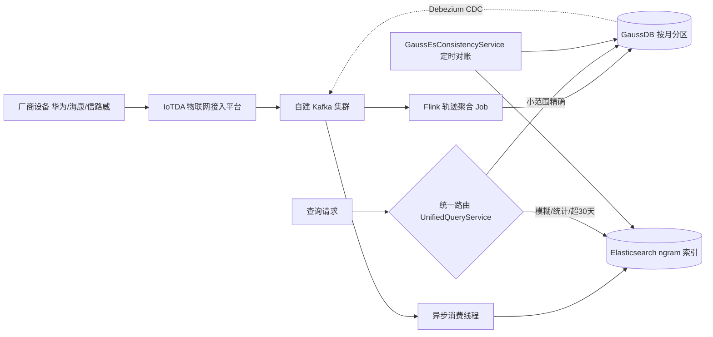

## 用户需求概述

针对高速公路车辆监测系统的三张核心大表（门架抓拍流水 `ods_rt_szdn_snapshot_flow_addcode`、收费流水 `ods_lwzxsfsj_fee_records_01`、车辆轨迹 `zdata_trail_fitting`），在日增 70 万、单表 3 年约 8 亿、合计约 24 亿的数据规模下，提供"最近一年时间范围 + 通用字段全模糊 + 导出 + 统计"的查询能力。

## 核心交付

- 编写/完善《8亿级大表查询架构设计与落地方案》设计文档：包含生产级技术选型横向对比（单表索引 / 分库分表 / PostgreSQL月度分区+ES混合 / ClickHouse / TiDB / 纯ES）、GaussDB 与 ES 一致性设计方案（双写 + Debezium CDC + Redis 水位增量同步 + 定时对账修复）、分区/索引/查询路由/导出（PIT+search_after）/统计（预聚合+ES聚合）方案与落地清单。
- 完善生产级代码（全部带中文+英文注释，说明方法思路与目的）：ES 索引管理、GaussDB↔ES 一致性对账服务、三表统一查询路由、三表 ES 同步（真实水位）、查询控制器接入三表并补齐 `/carTrackQueryByCarNo` 等接口。

## 查询接口与字段约束

- 门架抓拍流水 `/base/snapshotflow/list`：时间字段 `snapshottime`
- 收费流水 `/base/feerecords/list`：时间字段 `transtime`
- 车辆历史轨迹 `/carTrackQueryByCarNo`：时间字段 `extime`
- 全模糊字段：platenumber、orgname、sectionname、roadname、gantryname、tollname（轨迹表仅 platenumber）

## 技术栈（复用现有项目）

- 后端：Spring Boot 2.4.5 + Java 8；持久层 MyBatis-Plus 3.5.1 + dynamic-datasource（主库 GaussDB/PostgreSQL）
- 检索：Elasticsearch 7.17.0（rest-high-level-client），使用 ngram 分词 + .ngram/.keyword 多字段
- 流处理：Flink 1.13.2（Scala 2.11），Kafka；消息队列 Kafka/Pulsar/RocketMQ/RabbitMQ
- 缓存/水位：Redis（RedisTemplate）
- 已存在可复用组件：`LargeScaleDataSyncService`（游标分页 + 背压队列 + BulkProcessor）、`UnifiedQueryService`（三表路由）、`EsIndexManageService`、`KafkaProducerService`/`DataReliabilityService`/`DataLossDetectionService`、`debezium/` 下 GaussDB CDC→Kafka 配置

## 实现方案

总体沿用"GaussDB 按月分区（RANGE）持久化原始与轨迹数据 + Elasticsearch 承担全模糊/统计/导出"的混合架构，不引入分库分表。本次完善聚焦三块：① 设计文档补全多方案对比与一致性设计；② 索引管理补齐 ngram/ILM；③ 一致性对账与三表同步/查询落地。

关键决策：

1. 技术选型对比结论采用"PostgreSQL 月度分区 + ES(nGram) 混合"——分区裁剪使一年查询仅扫 12 个分区（~6.7GB/分区），全模糊走 ES 倒排索引（pg_trgm 在 8 亿行扛不住），避免分库分表的跨片 JOIN/排序/聚合/扩容代价。
2. 一致性采用"应用双写 ES（异步，以 datauuid 为 _id 幂等）+ Redis 水位增量同步 + Debezium CDC 兜底 + 定时对账 reconciliation 修复"四层保障，解决异步线程消费 Kafka 写 ES 与 GaussDB 之间的漂移。
3. 三表同步复用 `selectByCursorShard` 游标分页（O(offset)→O(total)），背压队列 + BulkProcessor 批量写入；将单表同步扩展为 SNAPSHOT/FEE/TRAIL 三表，注入 RedisTemplate 实现真实水位。
4. 查询路由：模糊字段/超 30 天/FEE/TRAIL 走 ES；小范围精确走 PG 分区裁剪；ES 异常降级 PG（补全模糊与时间过滤的降级 SQL）。

## 性能与可靠性

- 增量同步水位向后留 10s 缓冲，避免 GaussDB 写入延迟丢数据；对账按时间分区比对条数/水位，差异触发 repairSync。
- BulkProcessor 批量 1000 条/10MB/5s，指数退避重试；背压队列有界（10000）防 OOM。
- 导出用 ES PIT + search_after 替代 from+size 深分页（OFFSET>10000 拒绝）。
- 不改动无关文件，保持与既有 `service/optimization/*` 架构一致。

## 架构数据流（Mermaid）



## 目录结构（新增/修改）

```
car-monit-api/
├── docs/
│   └── 8亿级大表查询架构设计与落地方案.md   # [NEW] 设计文档：场景指标、技术选型横向对比表+结论、数据流、GaussDB↔ES一致性设计、分区/索引/查询路由/导出/统计方案、落地清单（引用现有 SQL 与 docs/大表查询性能优化方案.md，不重复粘贴）
├── pro-business-api/src/main/java/com/ruoyi/base/service/optimization/
│   ├── EsIndexManageService.java           # [MODIFY] 补齐 ngram analyzer、platenumber/orgname/sectionname/roadname/gantryname/tollname 的 .ngram 与 .keyword 子字段 mapping、ILM 生命周期（hot/warm/cold/frozen），确保 buildFuzzyQuery 可用；中英注释
│   ├── GaussEsConsistencyService.java       # [NEW] 一致性对账与修复服务：定时 reconciliation 按时间分区比对 GaussDB 与 ES 条数/水位，输出差异并触发 repairSync；双写辅助；中英注释
│   ├── UnifiedQueryService.java             # [MODIFY] 补全 FEE/TRAIL 真实 ES 查询与路由；强化 MySQL 降级路径（带时间+模糊过滤 SQL）；中英注释
│   └── LargeScaleDataSyncService.java       # [MODIFY] 注入 RedisTemplate 实现真实水位读写；将同步从 SNAPSHOT 单表扩展为 SNAPSHOT/FEE/TRAIL 三表，复用游标分页+背压+BulkProcessor；中英注释
├── pro-business-api/src/main/java/com/ruoyi/base/controller/
│   └── LargeScaleQueryController.java       # [MODIFY] 补全 /fee 真实调用；新增 /trail 与 /carTrackQueryByCarNo 接入三表查询；补齐导出/统计入口；中英注释
└── pro-business-api/src/main/resources/
    └── application.yml                      # [MODIFY] 补充三表 ES 索引名、一致性对账开关/间隔、Debezium 兜底等配置项
```

## 关键代码结构（一致性服务契约）

```java
// 一致性对账服务：对比 GaussDB 与 ES 在某一时间分区内的数据量/水位，发现漂移并触发修复
public interface GaussEsConsistencyService {
    /** 按时间分区对账：返回漂移报告（缺失/多余的 datauuid 区间） Reconcile by monthly partition, return drift report */
    ConsistencyReport reconcile(String tableName, String indexName, Date start, Date end);
    /** 依据对账差异触发指定时间窗口的补同步 Repair sync for the drifted time window */
    void triggerRepair(String dataSource, String startTime, String endTime);
}
```