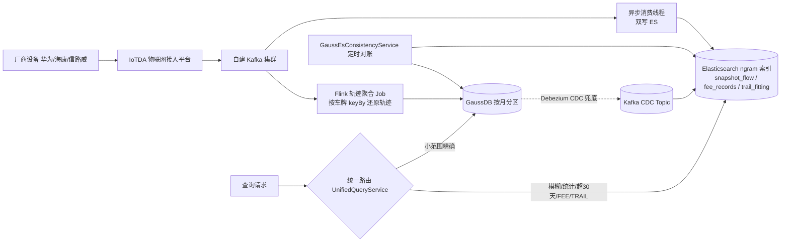

# 8 亿级大表查询架构设计与落地方案

> 适用场景：高速公路车辆监测系统中，门架抓拍流水、收费流水、车辆轨迹三张核心表，单表 3 年约 8 亿行、三表合计约 24 亿行，需支撑「最近一年时间范围 + 通用字段全模糊 + 导出 + 统计」的查询能力。
>
> 本文档为生产级技术选型对比与落地方案，配套代码见 `pro-business-api/src/main/java/com/ruoyi/base/`（查询路由、ES 索引管理、数据同步、一致性对账）以及 `docs/大表查询性能优化方案.md`（分区/索引细节）。两者互为补充，本文不重复粘贴 SQL，仅引用。

---

## 一、业务场景与数据量指标

### 1.1 三张核心表与查询接口

| 业务表 | 物理表名 | 查询接口 | 时间范围字段（分区键） | 通用全模糊字段 |
|--------|----------|----------|------------------------|----------------|
| 门架抓拍流水 | `ods_rt_szdn_snapshot_flow_addcode` | `/base/snapshotflow/list` | `snapshottime`（抓拍时间） | platenumber, orgname, sectionname, roadname, gantryname, tollname |
| 收费流水 | `ods_lwzxsfsj_fee_records_01` | `/base/feerecords/list` | `transtime`（计费交易时间） | platenumber(物理字段 `vehicleplate`), orgname, sectionname, roadname, gantryname, tollname |
| 车辆历史轨迹 | `zdata_trail_fitting` | `/carTrackQueryByCarNo` | `extime`（出口时间） | platenumber(物理字段 `envehicleid`) |

> **字段映射说明**：收费流水表的车牌字段物理名为 `vehicleplate`，轨迹表的车辆编号字段物理名为 `envehicleid`。对外统一以「platenumber」作为通用查询入参，在查询路由层（见 §5.3）翻译为对应物理字段，对调用方透明。

### 1.2 数据规模

| 维度 | 数值 |
|------|------|
| 单表日增 | ~70 万条 |
| 单表月增 | ~2000 万条 |
| 单表 3 年累计 | ~8 亿条 |
| 三表合计 | ~24 亿条 |
| 查询时间窗 | 最近 12 个月 |
| 模糊查询 | 6 个通用字段全模糊（`LIKE '%xxx%'`） |
| 导出 | 百万级 CSV/Excel |
| 统计 | 按门架/路段/日等维度 Top-N 与趋势 |

### 1.3 查询特征（决定架构的关键）

1. **所有查询都带时间范围**（分区裁剪的基础）。
2. **全模糊查询占比高**：`LIKE '%xxx%'` 在 8 亿行上走不了 B-tree 索引。
3. **统计/导出是大结果集**：不能拉到应用层聚合，不能 `from+size` 深翻页。
4. **数据持续写入**（Flink 实时聚合 + Kafka 异步落库），要求查询侧与写入侧解耦。

---

## 二、技术选型横向对比（生产级）

### 2.1 候选方案一览

| 方案 | 写入 | 全模糊查询 | 聚合/统计 | 扩展能力 | 运维复杂度 | 成本 |
|------|------|-----------|-----------|----------|------------|------|
| ① 单表 + 复合/B-tree 索引 | 优 | **差**（8 亿行 `LIKE` 全表扫，10s+） | 中（单表聚合，慢） | 差（扩容即大表 `ALTER`） | 低 | 低 |
| ② 分库分表（ShardingSphere，hash 取模） | 优 | 中（每片扫后归并，跨片慢） | **差**（跨库 JOIN/排序/聚合需中间件二次归并） | 中（加节点需全量迁移） | **高**（分布式事务、广播表） | 中 |
| ③ PostgreSQL 月度分区 + Elasticsearch(nGram) 混合（**选用**） | 优 | **优**（ES 倒排索引，百毫秒级） | **优**（ES aggregation 分布式并行） | 优（按月追加分区、ES 横向扩容） | 中（需运维两套存储） | 中 |
| ④ ClickHouse（物化视图 + MergeTree） | 中（写入需攒批/去重复杂） | 中（like 走 `ngram`/`tokenbf`，但高并发点查弱） | **优**（列存聚合极强） | 优 | 中（独立引擎，SQL 方言差异） | 中 |
| ⑤ TiDB（分布式 NewSQL） | 优（兼容 MySQL 协议） | 中（分区 + 二级索引，亿级 `LIKE` 仍慢） | 中（分布式聚合，但大查询易被打满） | 优（弹性扩容） | 中高（PD/TiKV/TiFlash 组件多） | 高 |
| ⑥ 纯 Elasticsearch | 优（天然全文检索） | **优** | **优** | 优 | 中（索引生命周期/映射治理） | 中高（存算全在 ES，成本高） |

### 2.2 选型结论与理由

**采用方案 ③：PostgreSQL(本场景为 GaussDB) 月度分区持久化原始/轨迹数据 + Elasticsearch 承担全模糊/统计/导出。**

理由：

1. **不引入分库分表（否决 ②）**：本系统查询几乎都带时间范围，月度分区即可把一年查询裁剪到 12 个分区（每个 ~6.7GB），分区裁剪效率最高；而分库分表在跨片 JOIN（流水表 JOIN 门架元数据）、排序、聚合、扩容迁移上有难以承受的代价，与本场景不匹配。
2. **不选 ①**：单表 + 索引在全模糊场景下延迟 10s+，无法接受。
3. **不选 ④⑤⑥ 作为主存储**：ClickHouse/TiDB 更适合离线分析或作为统计侧补充，纯 ES（⑥）存储成本与一致性治理成本高，且 GaussDB 仍承载写入与精确查询，作为系统 of record 更稳妥。
4. **ES 是模糊查询与统计的正确解**：ngram 倒排索引使 `LIKE '%赣A1%'` 从全表扫降为倒排查（百毫秒级）；aggregation 在分片并行计算，避免应用层拉全量。

> **演进建议**：若统计类查询（如按路段/日汇总）占比极高，可将方案 ③ 的统计部分下推到 ClickHouse（GaussDB→CDC→ClickHouse 物化视图），形成「GaussDB(明细) + ES(检索) + ClickHouse(分析)」三层架构。本文先落地方案 ③，统计通过 ES aggregation + 预聚合表（见 §5.5）满足，预留 ClickHouse 扩展点。

---

## 三、总体架构与数据流转



**职责划分**

| 组件 | 职责 |
|------|------|
| Kafka | 设备上报数据中转、解耦上下游 |
| Flink | 多源数据（Kafka CDC + 设备直连）按车牌聚合还原轨迹，State TTL 30 天，Checkpoint EXACTLY_ONCE |
| GaussDB | 系统 of record，按月分区持久化原始流水与轨迹，支撑小范围精确查询与 CDC 源头 |
| 异步消费线程 | 消费 Kafka 流水，异步双写 ES（以业务主键为 `_id` 保证幂等） |
| Elasticsearch | 全模糊检索、统计聚合、大数据量导出 |
| UnifiedQueryService | 查询路由：模糊/统计/超 30 天/FEE/TRAIL 走 ES，小范围精确走 GaussDB |
| LargeScaleDataSyncService | 全量/增量/补同步 GaussDB→ES，游标分页 + 背压 + BulkProcessor + Redis 水位 |
| GaussEsConsistencyService | 定时对账 GaussDB 与 ES 数据量/水位漂移，触发补同步修复 |

---

## 四、GaussDB ↔ Elasticsearch 一致性设计方案

### 4.1 问题定义

异步线程消费 Kafka 写 ES 与 GaussDB 之间天然存在时序漂移：写 DB 成功但写 ES 失败、ES 写入延迟、消息重复/丢失等。目标是**最终一致**（非强一致，因为 ES 不参与交易链路），并可在分钟级内自愈。

### 4.2 四层保障

#### 第一层：应用双写（Async Dual-Write，主路径）

- 数据写入 GaussDB 后，异步线程消费 Kafka（或落库成功后发事件）将同一条记录写入 ES。
- **幂等**：以业务主键 `datauuid`/`big_id`/`cid` 作为 ES 文档 `_id`，重复写入自动覆盖。
- **削峰**：写入经 `BulkProcessor`（批量 1000 条 / 10MB / 5s 先到先触发）+ 有界背压队列（10000）保护，避免 ES 被打满。
- 代码入口：Kafka 消费 → `LargeScaleDataSyncService`（双写语义在 `incrementalSync` / `repairSync`）。

#### 第二层：Redis 水位增量同步（日常补偿）

- 增量同步以「已同步到的最大时间」为水位，存于 Redis：`es:sync:watermark:{table}`。
- 每次增量拉取 `GaussDB.time > last_watermark` 且 `time < now-10s`（留 10s 缓冲，规避 GaussDB 写入延迟造成的漏读），同步成功后更新水位。
- 失败重投 + 水位不前进，保证至少一次（at-least-once），配合 `_id` 幂等实现 exactly-once 效果。

#### 第三层：Debezium CDC 兜底（捕获型补偿）

- 当应用双写链路故障（如 Kafka/ES 不可用），`debezium/`（GaussDB CDC → Kafka）持续捕获 GaussDB 行级变更，写入 CDC Topic。
- 独立的 CDC 消费者将变更回填 ES，作为「应用双写」的旁路兜底，覆盖双写缺失的窗口。
- 配置见 `debezium/config/connect-gaussdb-*.properties` 与 `debezium/config/source-connector-config.json`。

#### 第四层：定时对账 + 修复（Reconciliation，兜底中的兜底）

- `GaussEsConsistencyService` 按**月度分区**对 GaussDB 与 ES 在相同时间窗内做 `COUNT` 比对，发现漂移（条数不一致 / 抽样缺 `_id`）生成 `ConsistencyReport`。
- 漂移触发 `triggerRepair(ds, start, end)`，对漂移时间窗重跑 `LargeScaleDataSyncService.repairSync`，以 GaussDB 为准回灌 ES。
- 对账为低频任务（如每日凌晨），仅校验最近 N 个月，成本可控。

### 4.3 一致性级别小结

| 维度 | 保证 |
|------|------|
| 强一致 | 否（ES 不进交易链路） |
| 最终一致 | 是（分钟级，四层保障） |
| 幂等 | 是（`_id` = 业务主键） |
| 防丢 | 是（水位 + CDC 兜底 + 对账修复） |
| 防重 | 是（`_id` 覆盖 + 水位不回退） |

---

## 五、分区 / 索引 / 查询路由 / 导出 / 统计 方案

### 5.1 分区方案（GaussDB）

- 三张表统一 **按月 RANGE 分区**，分区键即时间字段（`snapshottime`/`transtime`/`extime`）。
- 3 年共 36 个分区，单分区 ~6.7GB；一年查询仅扫 12 个分区。
- **禁止按小时/日分区**（3 年 26280 个分区，元数据开销爆炸）。
- 分区自动管理：`pg_cron` 每月建下月分区、DROP 超 13 个月分区（DDL 见 `docs/大表查询性能优化方案.md` §四）。

### 5.2 索引方案

- **GaussDB 侧**：时间字段 `DESC` B-tree（分区裁剪）+ 时间+编码联合索引 + 覆盖索引（INCLUDE）；`pg_trgm` GIN **仅作为 ES 不可用时的降级模糊方案**。
- **ES 侧**：通用模糊字段统一 `keyword` 基字段 + `.ngram` 子字段（`min_gram=2, max_gram=4`, `token_chars=[letter,digit]`，lowercase）。
  - 精确匹配（完整车牌/代码，≥7 字符）→ `term` on `.keyword`。
  - 中长度（3–6 字符）→ `match` on `.ngram`（核心路径）。
  - 极短（1–2 字符）→ `wildcard` on `.keyword`（语义正确但性能较低，限制使用）。
- **ILM 生命周期**：`hot(0–30d, 5 shard/1 replica/refresh 5s)` → `warm(30–90d, shrink 1 shard/forcemerge)` → `cold(90–365d, frozen)` → `delete(>365d)`。创建见 `EsIndexManageService.createIndexLifecyclePolicyIfAbsent`。

### 5.3 查询路由策略（`UnifiedQueryService`）

```
if (存在任意模糊字段)                      → ES        // MySQL LIKE 走不了索引
else if (时间跨度 > es-force-days(30))     → ES        // 大范围扫分区代价高
else if (数据源 == FEE || TRAIL)          → ES        // 场景复杂，默认 ES
else                                       → GaussDB   // 小范围精确，分区裁剪 + B-tree
ES 异常                                     → 降级 GaussDB（带时间+模糊过滤）
```

- **逻辑字段 → 物理字段翻译**（对调用方透明）：`platenumber` 在 SNAPSHOT→`platenumber`、FEE→`vehicleplate`、TRAIL→`envehicleid`；其余字段同名。
- **强制时间范围**：无时间范围或跨度 > 365 天直接拒绝（防全表扫）。
- **浅分页上限**：`from+size` 超过 `max_result_window(10000)` 拒绝，引导使用导出接口。

### 5.4 导出方案（大数据量）

- 使用 **ES PIT + search_after** 替代 `from+size` 深翻页（OFFSET 越大越慢，且超 10000 报错）。
- 异步提交：返回 `taskId`，后台线程滚动拉取 → 流式写 CSV（每 10 万条切一个文件）→ 轮询/下载。
- 关键：及时 `ClearScroll` 释放服务端游标资源。
- 代码：`LargeScaleQueryService.submitExportTask` / `executeExportScroll`（已泛化为三表 `type`）。

### 5.5 统计方案

- **灵活统计**：ES aggregation（terms/date_histogram）在分片并行计算，不拉原始数据。代码：`LargeScaleQueryService.aggregationStats`。
- **高频固定统计**：GaussDB 预聚合表（如 `stats_snapshot_hourly`），每小时物化一次，查询毫秒级（DDL 见 `docs/大表查询性能优化方案.md` §九）。`HundredMillionLevelQueryService` 已提供物化视图缓存封装。

---

## 六、落地里程碑与实施清单

| 阶段 | 措施 | 优先级 | 交付物（本仓库） |
|------|------|--------|------------------|
| P0 | 三表按月分区 + 自动管理 | P0 | `docs/大表查询性能优化方案.md` §四 SQL |
| P0 | ES 索引（ngram + ILM）初始化 | P0 | `EsIndexManageService`（增强）+ `es/index/*.json` |
| P0 | 三表全量/增量/补同步 GaussDB→ES | P0 | `LargeScaleDataSyncService`（三表 + Redis 水位） |
| P0 | 统一查询路由（三表） | P0 | `UnifiedQueryService`（增强）+ `LargeScaleQueryController`（接入三表） |
| P1 | GaussDB↔ES 一致性对账修复 | P1 | `GaussEsConsistencyService`（新增） |
| P1 | Debezium CDC 兜底回灌 | P1 | `debezium/` 配置 + CDC 消费者 |
| P1 | 导出 PIT + search_after（三表） | P1 | `LargeScaleQueryService`（泛化） |
| P1 | 统计 aggregation + 预聚合表 | P1 | `LargeScaleQueryService` + 预聚合表 |
| P2 | 查询限流/熔断、慢查询监控 | P2 | — |
| P2 | 冷数据迁移 ES frozen tier / 对象存储 | P2 | ILM `cold`/`delete` 阶段 |
| 日常 | `ANALYZE` 更新统计信息、`pg_stat_statements` 慢查询 | 日常 | — |

---

## 七、代码模块说明（与本文档配套）

| 文件 | 角色 | 关键方法 |
|------|------|----------|
| `service/optimization/EsIndexManageService.java` | ES 索引初始化 + ngram + ILM | `createIndexIfAbsent`, `createIndexLifecyclePolicyIfAbsent`, `attachLifecyclePolicy` |
| `service/optimization/UnifiedQueryService.java` | 三表统一查询路由 | `query(ds,...)`, `shouldRouteToEs`, `buildFuzzyQuery`, 逻辑→物理字段翻译 |
| `service/optimization/LargeScaleDataSyncService.java` | 三表 GaussDB→ES 同步 | `fullSyncOneYear`, `incrementalSync`(Redis 水位), `repairSync`, `SyncTask` |
| `service/optimization/GaussEsConsistencyService.java` | 一致性对账与修复 | `reconcile`, `triggerRepair`, 定时 `scheduledReconcile` |
| `service/optimization/LargeScaleQueryService.java` | 三表导出/统计 | `fuzzyQuery(type,...)`, `aggregationStats(type,...)`, `submitExportTask(type,...)` |
| `controller/LargeScaleQueryController.java` | 对外 HTTP 接口 | `/snapshot`, `/fee`, `/trail`, `/carTrackQueryByCarNo`, 导出/统计 |

> 所有配套代码均含中文 + 英文注释，并说明方法思路与目的（见对应源码文件头部与关键方法注释）。
