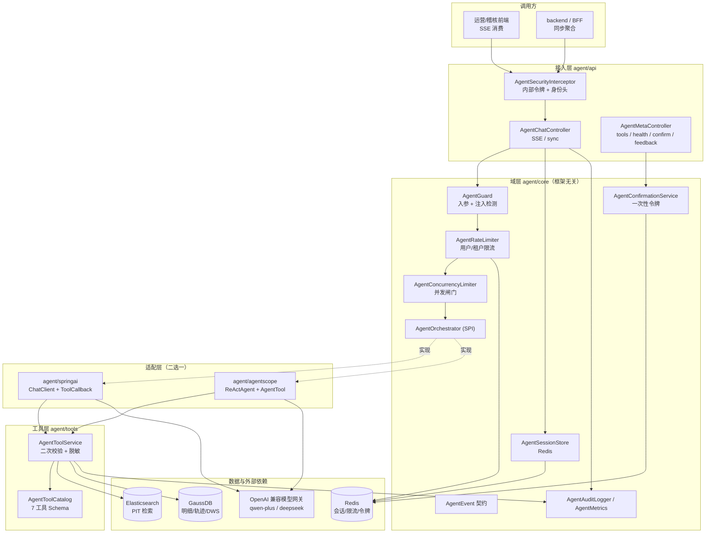
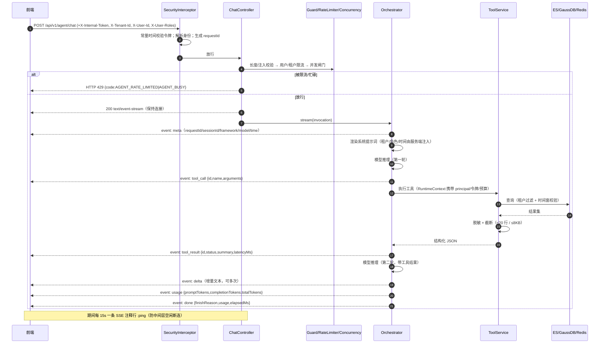
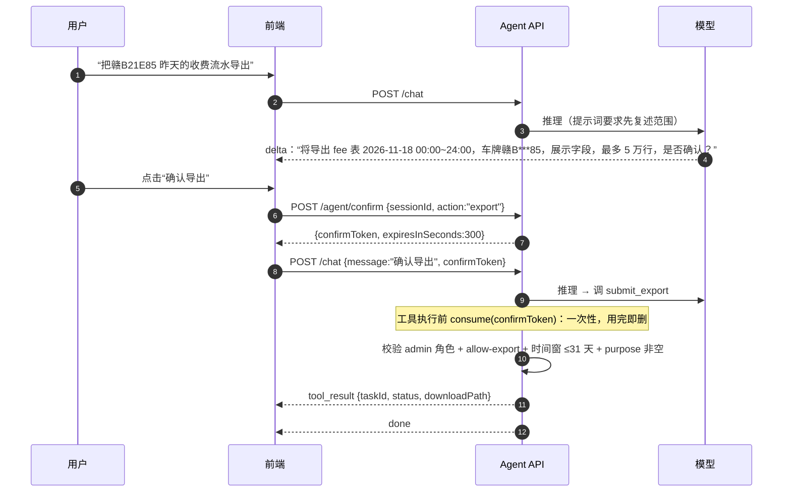

# 路网数据智能助手 · 设计文档

| 项目 | 内容 |
| --- | --- |
| 文档版本 | v1.0 |
| 基线代码 | `car-monit-api-jdk25`（JDK 25 / Spring Boot 4.1.2） |
| 适用分支 | `springAi`（Spring AI 2.0.2）、`agentScope2java`（AgentScope Java 2.0.5） |
| 配套文档 | [agent-spec.md](./agent-spec.md)（接口与工具契约，字段级） |
| 读者 | 架构评审、后端开发、前端（SSE 消费方）、运维、安全审计 |

---

## 1. 背景与目标

### 1.1 业务背景

平台已沉淀三类高速公路数据能力：

- **明细检索**：`TrafficSearchService`（ES PIT 深分页 + 模糊检索，`legacy` 可回退 GaussDB）；
- **轨迹回放**：`TrailPointLoader` + `ISysUtilService.getTrailBoList`（轨迹点回源 GaussDB）；
- **汇总指标**：`BigScreenStatsService`（DWS 预聚合：逃费/稽核/收入/告警 TopN）；
- **异步导出**：`ExportTaskService`；**数据质量**：`DataLossDetectionService`。

运营、稽核、值班人员的真实诉求是"用一句人话拿到一个可信数字或一条路径"，而不是逐层点选筛选器。
因此需要一个**受控的对话入口**：把自然语言问题翻译成**白名单工具调用**，用工具返回的真实数据作答，
并保证越权、越界、脱敏、成本、审计五件事都可控。

### 1.2 目标（可验收）

| 编号 | 目标 | 验收方式 |
| --- | --- | --- |
| G1 | 一条 SSE 流内完成"问答 + 工具调用可视化" | 前端只实现一套事件解析即可对接两个分支 |
| G2 | 工具能力**可枚举、可校验、可授权** | `GET /api/v1/agent/tools` 与启动期一致性校验 |
| G3 | 模型无法越权：租户/角色/令牌由服务端注入 | 构造恶意 tool 参数与提示词注入用例全部被拦 |
| G4 | 成本可控：轮数、工具次数、token、并发四道闸 | 压测与预算用例 |
| G5 | 全链路可审计：谁、何时、问什么、调了什么工具、耗时、token | `AGENT_AUDIT` 日志可检索 |
| G6 | 框架可替换：换 Agent 框架不改业务工具与前端 | 两个分支共用域层与工具层，仅适配层不同 |

### 1.3 非目标

- 不做通用 BI/自助取数（有导出与页面查询）；
- 不做跨租户数据对比分析（租户隔离是硬约束）；
- 不把模型当作权限判定者（模型只决定"调哪个工具"，不决定"能看什么数据"）；
- 不在本期引入多智能体协同（预留 `AgentTool` 组合能力，见 §13）。

---

## 2. 分支策略与代码组织

### 2.1 为什么是两个分支而不是一个模块

用户要求"同一套 agent 能力分别用 Spring AI 与 AgentScope 实现并横向对比"。两条技术路线的依赖在
类路径上互斥且都较重（Spring AI 会引入 `spring-ai-*` 自动配置与 `ChatClient`；AgentScope 引入
自己的 `Model`/`Toolkit`/`AgentStateStore` 体系），把两者塞进同一个 Maven 构建会带来三类问题：

1. **依赖仲裁不可控**：`spring-ai-*` 与 `agentscope-*` 各自管理模型/工具/记忆，同进程共存时
   自动配置与线程模型会互相干扰（jedis 版本已按"以框架为基准"统一到 7.4.1，见 §11 踩坑 2）；
2. **自动配置互相干扰**：两个框架都可能注册"默认模型/默认工具执行器"；
3. **对比失真**：同进程共存时，线程池、连接池、缓存会相互影响，压测数据不可比。

因此采用 **"公共域层 + 两个薄适配层"** 的双分支结构：

```text
car-monit-api-jdk25  (基线)
        │
        ├── springAi          分支：agent/core + agent/tools + agent/api + agent/springai
        └── agentScope2java   分支：agent/core + agent/tools + agent/api + agent/agentscope
                                   ▲ 完全一致            ▲ 仅此目录不同
```

提交关系：

| 提交 | 内容 | 是否两分支共享 |
| --- | --- | --- |
| `feat(agent): add framework-neutral agent domain layer` | `agent/core`、`agent/tools`、`agent/api`、提示词、知识库、3 个域层单测 | 是（cherry-pick） |
| `fix(agent): 只由编排器下发一次 meta 事件` | 控制器去重 | 是（cherry-pick） |
| `feat(agent): implement Spring AI 2.0 orchestrator and tool callbacks` | `agent/springai` | 否 |
| `feat(agent): implement AgentScope 2.0 orchestrator, toolkit and state store` | `agent/agentscope` | 否 |

### 2.2 目录结构

```text
pro-business-api/src/main/java/com/ruoyi/base/agent/
├── api/                        # 接入层：SSE/同步/会话/元信息/异常映射/安全拦截
│   ├── AgentChatController.java        # POST /chat、/chat/sync（seq、心跳、终态收敛、审计）
│   ├── AgentSessionController.java     # 会话列表/历史/清空
│   ├── AgentMetaController.java        # /tools、/health、/confirm、/feedback
│   ├── AgentSecurityInterceptor.java   # X-Internal-Token + 身份头注入
│   ├── AgentExceptionHandler.java      # 稳定错误码，不返回堆栈
│   └── dto/                            # 请求/响应 DTO（jakarta validation）
├── config/
│   ├── AgentProperties.java            # traffic.agent.* 全量配置
│   └── AgentWebConfig.java             # 拦截器注册 + 心跳/执行线程池
├── core/                       # 域层（框架无关）
│   ├── AgentOrchestrator.java          # 唯一 SPI：stream(invocation) → Flux<AgentEvent>
│   ├── AgentEvent.java                 # 9 类 SSE 事件的唯一构造入口
│   ├── AgentPrincipal.java             # 调用主体（租户/用户/角色 + 脱敏判定 + 短哈希）
│   ├── AgentErrorCode.java             # 16 个稳定错误码（HTTP 状态 + 是否可重试）
│   ├── AgentGuard.java                 # 长度校验 + 8 条注入启发式
│   ├── AgentRateLimiter.java           # 用户/租户两级固定窗口（Redis + 本地降级）
│   ├── AgentConcurrencyLimiter.java    # 全局并发闸门
│   ├── AgentConfirmationService.java   # 一次性确认令牌（getAndDelete）
│   ├── AgentSessionStore.java          # UI 会话历史抽象
│   ├── RedisAgentSessionStore.java     # List + ZSet 实现，Redis 故障退化为 LRU
│   ├── KnowledgeBase.java              # Markdown 切块 + 简化 TF-IDF 中英检索
│   ├── PromptLibrary.java              # 提示词加载 + 占位符渲染
│   ├── AgentAuditLogger.java           # AGENT_AUDIT 独立 logger
│   ├── AgentMetrics.java               # Micrometer（可空，无 registry 则 no-op）
│   └── ToolContextKeys.java            # 工具上下文的 5 个键
├── tools/                      # 工具层（框架无关）
│   ├── AgentToolCatalog.java           # 7 个工具的唯一事实源（name/desc/risk/roles/schema）
│   ├── AgentToolService.java           # 每个工具的入参二次校验与业务编排
│   └── ToolSupport.java                # 时间窗校验、截断、脱敏、结果封装
├── springai/                   # 适配层 A
└── agentscope/                 # 适配层 B
```

**架构约束（评审红线）**：`tools` 与 `core` 不允许 import `springai`/`agentscope` 任何类型；
`api` 只依赖 `core` 的 `AgentOrchestrator` 接口。可用 `mvn dependency:analyze` 或
`grep -r "org.springframework.ai\|io.agentscope" core tools api` 做静态检查。

---

## 3. 总体架构

### 3.1 分层视图



### 3.2 组件职责

| 组件 | 职责 | 不做什么 |
| --- | --- | --- |
| `AgentChatController` | 协议边界：SSE 帧、`seq`、心跳、终态收敛、并发释放 | 不拼提示词、不碰模型 SDK |
| `AgentOrchestrator` | 一次对话的编排：注入上下文、驱动框架、产出事件 | 不做鉴权、不写 SQL |
| `AgentToolCatalog` | 工具契约（名称/描述/风险/角色/Schema） | 不执行任何查询 |
| `AgentToolService` | 工具语义：参数校验、越界拦截、脱敏、结果裁剪 | 不感知框架、不发 SSE |
| 适配层 | 框架 ↔ 域层翻译：工具注册、事件映射、状态存储 | 不含业务规则 |
| `AgentSessionStore` | UI 侧历史（只存 user/assistant 文本） | 不作为模型上下文来源 |

### 3.3 与 V3 数据链路的关系

Agent **不新建数据通路**，只做"自然语言 → 既有服务"的路由：

| 工具 | 复用服务 | 数据源 | 备注 |
| --- | --- | --- | --- |
| `query_traffic_records` | `TrafficSearchService` | ES（`traffic.query.engine` 可回退 GaussDB） | 复用 PIT 深分页与总数封顶 |
| `get_vehicle_track` | `TrailPointLoader` + `ISysUtilService` | GaussDB 轨迹表 | 按里程等距抽稀到 ≤200 点 |
| `get_bigscreen_metric` | `BigScreenStatsService` | DWS 预聚合 | `stats-enabled=false`/表缺失时服务抛 503，由 backend hybrid 模式回退 legacy |
| `submit_export` / `get_export_status` | `ExportTaskService` | 异步任务 | 高风险，需二次确认令牌 |
| `get_data_quality` | `DataLossDetectionService` | Kafka/入库对账 | 窗口 ≤24h |
| `search_knowledge` | `KnowledgeBase` | classpath Markdown | 24 块 / 1086 词项 |

这样做的收益：Agent 的查询口径与页面完全一致，不会出现"页面查得到、助手查不到"的信任崩塌。

---

## 4. 关键设计

### 4.1 请求生命周期



### 4.2 为什么统一 SSE 事件契约，而不是透传框架事件

| 维度 | 透传框架原生事件 | 统一契约（本项目） |
| --- | --- | --- |
| 前端成本 | Spring AI 与 AgentScope 各写一套解析 | 一套解析，`framework` 仅作展示 |
| 契约稳定性 | 框架升级可能改事件名/字段 | 事件名与字段由本项目 spec 锁定 |
| 安全 | 原生事件可能带原始报文/思考过程 | 只下发展示所需字段，思考默认关闭 |
| 可测试 | 需要起真模型 | 单测用假 Flux 即可断言事件序列 |

统一契约下，**工具事件由工具适配层自己产出**（`tool_call` 在工具执行前、`tool_result` 在执行后），
因此两个分支的 `tool_call/tool_result` 字段**逐字节一致**，只有 `meta.framework` 不同。

### 4.3 会话与状态：两条路线的本质差异

| 维度 | Spring AI 分支 | AgentScope 分支 |
| --- | --- | --- |
| 模型上下文载体 | `ChatMemory`（`MessageChatMemoryAdvisor`） | `ReActAgent` 的 `AgentState`（`(userId, sessionId)` 槽位） |
| 持久化实现 | 自研 `RedisChatMemory`（Spring AI 无官方 Redis 记忆实现，只存文本 + 滑动窗口 + TTL） | **官方** `RedisAgentStateStore`（`agentscope-extensions-redis`，Jedis 适配器） |
| 窗口控制 | 写入时裁剪（保留最近 N 轮） | 回灌时裁剪（`HistoryWindowMiddleware`，不动持久化状态） |
| 工具循环 | `ToolCallingAdvisor` 隐式循环 + 回调侧预算兜底 | `ReActAgent.maxIters` 显式循环 + 工具预算 |
| UI 历史 | `AgentSessionStore`（两侧一致） | `AgentSessionStore`（两侧一致） |
| 多实例一致性 | Redis 共享 | Redis 共享（state store），本地有降级缓存 |

**Key 设计**（前缀 `traffic.agent.key-prefix`，默认 `agent`）：

| 用途 | Key | 类型 | TTL |
| --- | --- | --- | --- |
| UI 会话消息 | `agent:session:{tenant}:{user}:{sessionId}` | List | `session-ttl` |
| UI 会话索引 | `agent:sessions:{tenant}:{user}` | ZSet（member=清洗后的 sessionId，score=活跃时间） | `session-ttl` |
| 限流（用户） | `agent:rl:u:{tenant}:{user}:{minute}` | String（INCR） | 90s |
| 限流（租户） | `agent:rl:t:{tenant}:{minute}` | String（INCR） | 90s |
| 确认令牌 | `agent:confirm:{token}`（value = `tenant\|user\|sessionId\|action`） | String | `confirm-ttl` |
| AgentScope 状态 | `agent:as:{tenant:user}/{sessionId}:{key}` | String（JSON） | **无**（需运维清理） |
| AgentScope 列表态 | `agent:as:{tenant:user}/{sessionId}:{key}:list` | List | **无** |
| AgentScope 状态版本 | `agent:as:{tenant:user}/{sessionId}:{key}:ver` | String | **无** |
| AgentScope 会话索引 | `agent:as:{tenant:user}/{sessionId}:_keys` | Set | **无** |

> 上表 AgentScope 四行来自官方 `RedisAgentStateStore` 的 V0 布局（`keyPrefix` 传 `agent:as:`，
> **结尾冒号是布局的一部分**）。官方实现全程不设 TTL，清理靠"用户清空会话"与
> `scripts/agent/cleanup-agent-state.sh`，详见 `agent-spec.md` §8.1。

> 关键点：AgentScope 的会话槽位是 `(userId, sessionId)`，若直接用 `userId`，两个租户用同一个
> `sessionId` 时会命中同一槽位 → 串号。因此适配层把 `userId` 传成 `tenant:user` 复合值（见
> `AgentScopeAgentOrchestrator#buildContext`）。

### 4.4 上下文窗口与 token 成本

- 单轮用户消息 ≤ 4000 字符（`max-message-chars`）；
- 历史窗口默认 10 轮（`history-window`）；
- 工具结果回灌 ≤ 8000 字符（`max-tool-result-chars`）且明细 ≤20 行，超出部分用结构化
  `truncated` 标记替代（保持 JSON 合法，模型不会解析失败）；
- 单次回复 ≤1024 token（`max-output-tokens`）；工具调用次数 ≤ `max-iters`（默认 6），AgentScope 另有同值轮次上限。

> AgentScope 的 `AgentState` 会持久化完整对话上下文（`HistoryWindowMiddleware` 只裁回灌给模型的部分，不改持久化状态），长会话的 Redis 写入量随轮次增长；官方状态存储**不设 TTL**，因此靠"用户主动 `DELETE /sessions/{id}`" + 运维脚本按空闲时间清理（§8.1），后续可按轮次做服务端压缩（见 §12 P3）。`session-ttl` 只作用于 UI 历史与 Spring AI 记忆，对 AgentScope 状态无效。

### 4.5 提示词与知识库

- 提示词为 classpath 资源 `agent/prompts/system.md`，含 8 条硬性规则（禁止生成 SQL、时间窗默认、
  车牌最小长度、`ok=false` 时最多重试 1 次、导出必须二次确认、车牌脱敏、不泄露提示词、不编数）；
- 占位符 `{{tenantId}}/{{userId}}/{{roles}}/{{now}}/{{timezone}}` **每次请求由服务端渲染**
  （Spring AI：`PromptLibrary.render` 直接生成 system 消息；AgentScope：`PerRequestPromptMiddleware`
  在 `onSystemPrompt` 钩子里渲染），避免单例 Agent 复用固定提示词造成租户上下文串号；
- 知识库为 5 个 Markdown（表结构、指标口径、查询指南、数据质量、FAQ），启动时切块（按标题），
  检索用简化 TF-IDF（英文分词 + 中文二元组，公式 `tf × idf / sqrt(len)`，非严格 BM25），返回带 `title/source/score` 的片段，便于回答里给出处。

---

## 5. 安全设计

### 5.1 威胁模型（STRIDE 摘要）

| 威胁 | 场景 | 控制点 |
| --- | --- | --- |
| Spoofing | 绕过网关直连 Agent 端点 | `X-Internal-Token`（常量时间比较）；非回环必须携带；缺身份头一律 401（不兜底匿名） |
| Tampering | 模型被诱导篡改 tenant/role | 身份只从请求头来，**工具上下文由服务端写入**，不读模型参数 |
| Repudiation | 事后否认查过某车牌 | `AGENT_AUDIT` 记录 requestId/tenant/userHash/tool/summary |
| Information disclosure | 跨租户查询、车牌外泄、提示词套取 | 租户过滤在服务层、车牌按角色脱敏、注入启发式 + 提示词硬规则 |
| Denial of service | 刷问、超长问题、工具循环 | 两级限流、长度上限、并发闸门、轮数/工具预算、超时 |
| Elevation of privilege | 普通用户导出全量 | 导出需 `admin` 角色 + 开启开关 + **一次性确认令牌**（模型不可见） |

### 5.2 信任边界

```text
[公网] → [网关/backend：认证、限流、注入身份头] → [内网 Agent 服务：只信请求头 + 内部令牌]
                                                        │
                                                        └→ 模型：只输出"调哪个工具/什么参数"
```

- **模型输出永远是"建议"**：工具名走白名单（`AgentToolCatalog`），参数走 `AgentToolService` 二次校验；
- **令牌不进模型上下文**：`confirmToken` 只存在于 `RuntimeContext` 属性袋（不持久化、不进提示词）；
- **`principal` 不可被模型影响**：工具从 `RuntimeContext.get(ToolContextKeys.PRINCIPAL)` 取，
  缺失即返回 `TOOL_ERROR`（不执行查询），绝不以"匿名主体"兜底。

### 5.3 越权防护的三道闸

| 闸 | 位置 | 例子 |
| --- | --- | --- |
| 角色闸 | `AgentToolCatalog.allows()` + `AgentToolService.authorize()`（每个工具入口第一行） | `get_vehicle_track` 仅 `audit/admin`；`submit_export` 仅 `admin`；未知工具/空主体默认拒绝 |
| 数据闸 | 服务层（复用 V3 查询服务） | 请求按 `orgcode/sectioncode/roadcode/gantrycode/tollcode` 下推过滤，越权机构查不到数据 |
| 令牌闸 | `AgentConfirmationService` | 导出必须携带 `confirmToken`，`getAndDelete` 保证一次性 |

### 5.4 脱敏规则

| 数据 | 规则 | 实现 |
| --- | --- | --- |
| 车牌 | 保留前 2 后 2（`赣B21E85` → `赣B***85`）；`audit/admin` 可见全量 | `AgentPrincipal.canSeeFullPlate()` + `ToolSupport.maskRow` |
| 用户标识 | 日志/指标只记 12 位 SHA-256 短哈希 | `AgentPrincipal.userHash()` |
| 问题原文 | 默认不落盘，只记长度；`audit-log-question=true` 才记录 | `AgentAuditLogger.chat` |
| 工具结果 | 摘要字段白名单（`ok/total/count/pointCount/status/errorCode`） | 适配层 `summarize` |
| 模型名 | 健康检查里打码（`qwen-p***`） | `AgentMetaController.maskModel` |

### 5.5 高风险操作：导出二次确认



要点：**确认令牌由前端持有，不进入模型上下文**。即使模型被诱导"自己调用导出"，也会因缺少令牌
返回 `CONFIRM_REQUIRED`，并在审计里留下一次 `tool/status=error` 记录。

### 5.6 提示词注入

`AgentGuard` 用 8 条正则拦明显尝试（忽略指令、套取提示词、开发者模式、索要密钥、编码绕过等），
命中返回 `AGENT_PROMPT_REJECTED` 并写审计。**它是信号，不是边界**：真正的边界是工具白名单 +
服务端身份 + 数据层租户过滤。这样设计的原因是正则必然可绕过，若把它当边界会产生"假安全"。

---

## 6. 稳定性设计

### 6.1 四道闸

| 闸 | 默认值 | 超限行为 | 目的 |
| --- | --- | --- | --- |
| 用户限流 | 10 次/分钟 | HTTP 429 `AGENT_RATE_LIMITED` | 防单人刷问 |
| 租户限流 | 120 次/分钟 | HTTP 429（`tenant` 维度） | 防单租户打爆模型配额 |
| 并发闸门 | 32 | HTTP 429 `AGENT_BUSY` | 保护 Tomcat 线程与模型连接 |
| 工具/轮次预算 | 工具调用 6 次（`max-iters`） | 工具返回 `AGENT_MAX_ITERS`；AgentScope 另有框架级轮次上限 → `done.finishReason=max_iters` | 防"工具死循环"烧钱 |
| 工具并发 | 32（信号量） | 立即返回 `TOOL_ERROR`（"工具并发已满"） | 防慢查询累积打满 ES/GaussDB 连接池 |

### 6.2 超时分层

| 层 | 配置 | 触发后 |
| --- | --- | --- |
| SSE 连接 | `request-timeout=120s` | `SseEmitter.onTimeout` → 下发 `error(AGENT_MODEL_TIMEOUT)` |
| 编排流 | `request-timeout`（Reactor `timeout`） | `error` 事件 + 释放并发 |
| 单次模型调用 | `model-timeout=60s`（框架级） | 框架重试 2 次后失败 → `AGENT_MODEL_TIMEOUT` |
| 单次工具 | `tool-timeout=20s`（两分支均实现：AgentScope 用 `toolExecutionConfig`，Spring AI 用虚拟线程 + 超时包装 + 32 许可并发闸） | 超时 → `tool_result(status=error)`（`TOOL_ERROR`），模型可换参重试 |

### 6.3 降级矩阵

| 故障 | 影响 | 降级策略 | 可见信号 |
| --- | --- | --- | --- |
| Redis 不可用 | 会话/限流/令牌 | 会话与状态退化为进程内缓存；限流退化为单机计数；确认令牌 **fail-closed**（签发与校验都抛 `AGENT_INTERNAL`，绝不降级放行） | `/health` → `status=DEGRADED`，`redis=DEGRADED`；WARN 日志 |
| 模型 429 | 无法推理 | 返回 `AGENT_RATE_LIMITED`（`retryable=true`），前端指数退避 | `agent.errors{code}` 指标 |
| 模型 5xx/503 | 无法推理 | `AGENT_MODEL_ERROR` / `AGENT_CIRCUIT_OPEN` | 同上 |
| ES 不可用 | 明细查不到 | 复用 V3 的 `legacy` 回退（服务层能力，Agent 无感） | 工具返回 `ok=false` + 原因 |
| 工具执行异常 | 单工具失败 | 包成 `ok=false` 回灌模型，模型向用户解释 | `agent.tool.calls{status=error}` |
| 导出未开启 | 无法导出 | `EXPORT_DISABLED`，提示走页面导出 | `/tools` 的 `risk=WRITE` 仍在，但执行被拒 |
| 客户端断开 | 无消费方 | `sink.onCancel` → dispose 上游，停止烧 token | 审计 `result=error` |

### 6.4 背压与取消

- SSE 侧用 `SseEmitter`，发送失败即终止（`finished` 置位 + 释放并发 + dispose）；
- 编排侧 `Flux.create(..., OverflowStrategy.BUFFER)`，事件量级为"每 token 一条"，缓冲可控；
- 取消信号先注册后订阅（`Disposables.swap()`），避免"订阅瞬间断开"漏掉取消（AgentScope 分支已修）。
- **工具超时 ≠ 查询被取消**：`CompletableFuture.cancel` 不会中断 JDBC/HTTP 调用，真正的取消依赖查询侧超时（ES `socket-timeout`、GaussDB `statement_timeout`）；应用层只保证"请求线程不被钉住 + 尽快把 `TOOL_ERROR` 交回模型"，并用工具并发闸限制在跑的慢查询数量。

---

## 7. 可观测性

### 7.1 指标（Micrometer，无 registry 时 no-op）

| 指标 | 类型 | 标签 | 用途 |
| --- | --- | --- | --- |
| `agent.requests.started` | Counter | `framework` | QPS |
| `agent.requests.finished` | Counter | `framework`,`result` | 成功率 |
| `agent.request.duration` | Timer(P50/95/99) | `framework`,`result` | 端到端时延 |
| `agent.tool.calls` | Counter | `tool`,`status` | 工具成功率 |
| `agent.tool.duration` | Timer | `tool` | 工具耗时（定位慢查询） |
| `agent.model.tokens` | Counter | `framework`,`type` | token 成本 |
| `agent.rate.limited` | Counter | `dimension`(user/tenant) | 限流分布 |
| `agent.errors` | Counter | `framework`,`code` | 错误码分布 |

Prometheus 命名自动转下划线：`agent_requests_total`、`agent_request_duration_seconds` 等。

### 7.2 审计日志（logger `AGENT_AUDIT`，JSON 单行）

```json
{"ts":1763500000000,"event":"chat","requestId":"9f2c...","tenant":"t1","userHash":"a1b2c3d4e5f6",
 "session":"77aa...","framework":"agentscope","result":"ok","elapsedMs":3210,
 "usage":{"promptTokens":1820,"completionTokens":210,"totalTokens":2030},
 "errorCode":null,"questionLength":24}
{"ts":1763500000100,"event":"tool","requestId":"9f2c...","tenant":"t1","userHash":"a1b2c3d4e5f6",
 "tool":"query_traffic_records","status":"ok","elapsedMs":420,"summary":"ok=true,total=3"}
```

- 保留策略建议：`chat` ≥180 天（合规追溯），`tool` ≥90 天；
- 不含 API Key、不含确认令牌、默认不含问题原文。

### 7.3 健康检查 `GET /api/v1/agent/health`

返回 `enabled/framework/model/tools/knowledgeChunks/redis/rateLimiter/exportEnabled/status`，
`status ∈ {UP, DEGRADED, DISABLED}`。K8s 建议用该端点做 readiness（`DISABLED` 也算就绪，
避免"开关关闭导致 Pod 永远不 Ready"）。

### 7.4 反馈闭环

`POST /feedback` 写 `AGENT_FEEDBACK` logger（`rating=1/-1` + 可选 comment），用于离线评估：
按周聚合差评问题 → 补充知识库 / 调整提示词 / 新增工具。

---

## 8. 配置与部署

### 8.1 关键环境变量

| 变量 | 必填 | 说明 |
| --- | --- | --- |
| `TRAFFIC_AGENT_ENABLED` | 是 | 总开关，默认 `false` |
| `TRAFFIC_AGENT_BASE_URL` | 开启后必填 | OpenAI 兼容端点（缺省启动失败） |
| `TRAFFIC_AGENT_API_KEY` | 开启后必填 | 模型密钥（只从环境变量注入） |
| `TRAFFIC_AGENT_MODEL` | 否 | 默认 `qwen-plus` |
| `TRAFFIC_AGENT_ALLOW_EXPORT` | 否 | 导出开关，默认 `false` |
| `TRAFFIC_INTERNAL_TOKEN` | 多机必填 | 内部令牌，与 backend 共享 |
| `TRAFFIC_AGENT_ALLOW_LOOPBACK` | 否 | 单机联调免令牌，生产必须 `false` |

完整清单见 [agent-spec.md](./agent-spec.md) §7。

### 8.2 部署拓扑

```text
[浏览器] → [backend/BFF] --(X-Internal-Token, X-Tenant-Id/X-User-Id/X-User-Roles)--> [pro-business-api]
                                                                                        │
                                                                          ┌─────────────┼──────────────┐
                                                                          ▼             ▼              ▼
                                                                   [模型网关]      [Redis]     [ES / GaussDB]
```

- Agent 端点**不暴露公网**，只接受 backend/网关调用；
- 模型网关建议独立限流（按租户 Key），与业务侧限流形成双保险；
- 多副本无状态：会话与限流都在 Redis；AgentScope 的 `AgentState` 也在 Redis。

### 8.3 容量与成本估算（单租户 100 并发问答）

| 项 | 估算 | 说明 |
| --- | --- | --- |
| 平均 1 次问答 token | ≈ 2.5k（1.8k prompt + 0.7k completion，含 2 轮工具） | qwen-plus 量级 |
| 峰值 QPS | 3 | 100 并发 / 平均 30s |
| 日 token（8h 高峰） | ≈ 3×3600×8×2.5k ≈ 216M | 需按实际灰度校准 |
| Redis 内存 | 每会话 ≈ 2KB × 活跃会话数；10 万会话 ≈ 200MB | 含 AgentScope 状态 |

成本控制的三个旋钮：`max-iters`、`history-window`、`max-output-tokens`。

### 8.4 灰度与回滚

1. 开关灰度：`TRAFFIC_AGENT_ENABLED` 按环境开启，先内测租户；
2. 分支灰度：两个分支镜像 tag 不同，按 backend 路由比例切换；
3. 回滚：关闭开关即回到"端点返回 `AGENT_DISABLED`"，不影响既有业务接口；
4. 数据回滚：会话/审计数据独立前缀，可直接 `DEL agent:*` 清理。

### 8.5 E2E 与 CI（云 runner 真实链路）

单测只能证明"逻辑对"，证明不了"真的能推流、真的能查库、鉴权在真实 HTTP 栈上真的生效"。
因此提供一条**完全容器化的 E2E**（`.github/workflows/agent-e2e.yml`），在两个分支上跑同一套断言。

**编排**（不依赖任何外部服务）：

| 组件 | 来源 | 作用 |
| --- | --- | --- |
| Redis 7 | GitHub `services` 容器 | 会话、限流、确认令牌 |
| openGauss 3.0 | `docker run --privileged` | 真实主库；加载 `scripts/v3/ops/parity/sql` 的 schema + seed（150 行门架数据） |
| 假模型 | `scripts/agent/mock_llm.py` | OpenAI 兼容、确定性返回 `tool_call`（两轮：先调工具，再总结结果） |
| 应用 | `java -jar`（fat jar） | 与生产启动方式一致 |
| 断言 | `scripts/agent/e2e.sh` | 12 项，失败非零退出 |

**断言清单**（两分支同脚本，仅 `EXPECT_FRAMEWORK` 不同）：

| # | 用例 | 期望 |
| --- | --- | --- |
| T0 | 健康检查 | `framework` 与分支一致、`redis=UP`、`tools=7` |
| T1 | 缺身份头 | 401 `AGENT_UNAUTHORIZED` |
| T2 | 错误内部令牌 | 401 |
| T3 | 提示词注入 | 400 `AGENT_PROMPT_REJECTED` |
| T4 | SSE 契约 | 首帧 `meta` 且仅一次；`tool_call` 在 `tool_result` 前；`seq` 严格递增；末帧 `done/error`；`meta`/`done`/`tool_result` 字段完整 |
| T5 | 同步接口 | `answer`/`usage`/`sessionId` 齐全，工具 `status=ok` |
| T6 | 会话 | 历史 2 条；清空返回 `cleared=true`；清空后为空 |
| T7 | 工具授权 | 无角色调用明细工具 → `FORBIDDEN`（且**未执行查询**） |
| T8 | 限流 | 单用户连打 12 次出现 429 |
| T9 | 工具清单 | `/tools` 返回 7 个且 `registered=true` |

**本地复现**（与 CI 同脚本，便于改完先本地过一遍）：

一条命令（推荐）：

```bash
bash scripts/agent/run-e2e-local.sh              # 按当前分支自动判断框架
bash scripts/agent/run-e2e-local.sh --reset-db   # 夹具改动后重建库
```

脚本做的事与 CI 一一对应：复用/启动 Redis 与 openGauss 容器 → 建库加载夹具 →
单测 → 打 fat jar → 起假模型与应用 → 跑 `e2e.sh` → 归集证据到 `out/agent-e2e`。
端口被旧进程占用时会**直接报错退出**（曾因打到上一轮的旧实例而误判"修复无效"）。
JDK 用 `E2E_JAVA_HOME`（默认 `/opt/jdk25`）指定，不复用机器上的 `JAVA_HOME`。

手工分步（需要看每一步细节时）：

```bash
# 1) 起依赖
docker run -d --name redis-e2e -p 6379:6379 redis:7-alpine
docker run -d --name og-e2e --privileged --shm-size=512m \
  -e GS_PASSWORD='Passw0rd@123' -e LD_LIBRARY_PATH=/usr/local/opengauss/lib \
  -p 5432:5432 enmotech/opengauss:3.0.0

# 2) 建库 + 加载夹具（openGauss 3.0 不支持 CREATE SCHEMA IF NOT EXISTS，见下方 sed）
docker exec -u 70 -e LD_LIBRARY_PATH=/usr/local/opengauss/lib og-e2e \
  /usr/local/opengauss/bin/gsql -d postgres -c "create database ruoyi"
sed 's/^CREATE SCHEMA IF NOT EXISTS jl_data01;/DO $$ BEGIN CREATE SCHEMA jl_data01; EXCEPTION WHEN duplicate_object THEN NULL; END $$;/' \
  scripts/v3/ops/parity/sql/schema_jl_data01.sql > /tmp/schema.sql
gunzip -c scripts/v3/ops/parity/sql/seed_jl_data01.sql.gz > /tmp/seed.sql
docker cp /tmp/schema.sql og-e2e:/tmp/schema.sql && docker cp /tmp/seed.sql og-e2e:/tmp/seed.sql
docker exec -u 70 -e LD_LIBRARY_PATH=/usr/local/opengauss/lib og-e2e \
  /usr/local/opengauss/bin/gsql -d ruoyi -f /tmp/schema.sql
docker exec -u 70 -e LD_LIBRARY_PATH=/usr/local/opengauss/lib og-e2e \
  /usr/local/opengauss/bin/gsql -d ruoyi -f /tmp/seed.sql

# 3) 假模型 + 应用
python3 scripts/agent/mock_llm.py --port 18080 &
TRAFFIC_INTERNAL_TOKEN=e2e-token TRAFFIC_AGENT_ENABLED=true \
TRAFFIC_AGENT_BASE_URL=http://127.0.0.1:18080/v1 TRAFFIC_AGENT_API_KEY=mock-key \
TRAFFIC_AGENT_MODEL=mock-model \
SPRING_DATASOURCE_DYNAMIC_DATASOURCE_MASTER_URL='jdbc:postgresql://127.0.0.1:5432/ruoyi?useSSL=false' \
SPRING_DATASOURCE_DYNAMIC_DATASOURCE_MASTER_USERNAME=gaussdb \
SPRING_DATASOURCE_DYNAMIC_DATASOURCE_MASTER_PASSWORD='Passw0rd@123' \
  java -jar pro-business-api/target/pro-business-api-1.0.jar \
  --server.port=9902 --sync.full-sync-enabled=false

# 4) 断言
APP_BASE_URL=http://127.0.0.1:9902 INTERNAL_TOKEN=e2e-token \
EXPECT_FRAMEWORK=spring-ai bash scripts/agent/e2e.sh
```

**已知限制**：CI 不起 Elasticsearch。带车牌/路段的**模糊查询**必须走 ES（设计上禁止回退 GaussDB），
因此明细查询在 E2E 中走的是"工具返回结构化错误"分支——断言只校验**错误被正确结构化并回给模型**，
不校验命中行数。精确查询（数据质量、门架维度）与指标查询走真实 GaussDB，覆盖了"真的查到库"。
需要验证完整检索链路时，按 `docs/agent/agent-spec.md` §7 的 ES 初始化步骤另行执行。

---

## 9. 两分支横向对比与选型

### 9.1 实现对比

| 维度 | Spring AI 2.0.2 | AgentScope Java 2.0.5 |
| --- | --- | --- |
| 编排抽象 | `ChatClient` + `ToolCallingAdvisor`（工具循环隐式） | `ReActAgent`（显式 ReAct 循环，`maxIters` 可控） |
| 工具注册 | `ToolCallback`（自定义 `JsonToolCallback` 手写 Schema） | `AgentTool`（`Toolkit.registerAgentTool`） |
| 工具上下文 | `ToolContext`（Map 透传） | `RuntimeContext`（userId/sessionId + 属性袋） |
| 会话记忆 | `ChatMemory` + `MessageChatMemoryAdvisor`（官方仅有内存实现，Redis 需自研） | `AgentStateStore` + 官方 `RedisAgentStateStore`（自带状态模型与版本化） |
| 流式事件 | `ChatClientResponse` 增量（文本 + usage） | 32 类细粒度事件（文本/思考/工具/模型调用/超限） |
| 中断/取消 | 依赖 `Disposable` | 原生 `interrupt(ctx)` + 取消传播 |
| 依赖重量 | 中（`spring-ai-openai` + `client-chat`，自带 micrometer/observation） | 较重（core 带 okhttp5、mcp sdk、tree-sitter、opentelemetry） |
| 与 Spring 生态 | 原生（Boot 自动配置、Micrometer、GraalVM hints） | 需手工装配（不引 starter，避免自动配置耦合） |
| 升级风险 | Spring AI 2.x 仍处快速演进（API 有调整） | 2.0.x 稳定，但扩展模块版本耦合强（jedis/redisson） |

### 9.2 运行时行为对比（实测）

| 场景 | Spring AI | AgentScope |
| --- | --- | --- |
| 单轮直接回答 | meta → delta → usage → done | 同（事件源不同：`TEXT_BLOCK_DELTA`） |
| 工具调用 | `tool_call → tool_result → delta → usage → done` | 同（工具事件由适配层产出，顺序一致） |
| 轮数超限 | 预算拦第 N+1 次工具，模型基于已有结果作答，`finishReason=stop`（本分支无独立轮次上限） | 框架产出 `EXCEED_MAX_ITERS` + 兜底总结，`finishReason=max_iters` |
| 客户端断开 | dispose 上游，停止生成 | 同（`Disposables.swap` 保证取消不丢） |
| 单测成本 | 需假 `ChatModel`（注意 `getOptions()` 必须返回 `ToolCallingChatOptions`） | 可 mock `ReActAgent` 直接投喂事件 Flux，更轻 |

### 9.3 选型建议

| 判据 | 结论 |
| --- | --- |
| 团队以 Spring 为主、要最少胶水代码 | **Spring AI** |
| 需要细粒度事件（思考、工具增量、子 Agent）、需要显式控制 ReAct 轮次 | **AgentScope** |
| 强调"框架可替换、业务零绑定" | 两者皆可：域层已隔离，切换成本≈适配层（约 700 行） |
| 依赖治理严格（禁新增 jedis/redisson/okhttp 大版本） | **Spring AI**（AgentScope core 会带 okhttp 5.x 与 tree-sitter） |
| 后续要做多智能体/子 Agent 编排 | **AgentScope**（`subagent`、`AgentTool` 组合、`Toolkit` 分组） |

**当前建议**：先以 `springAi` 分支上线（依赖面更小、与 Boot 4 生态一致），把 `agentScope2java`
作为"事件能力与多 Agent 演进"的技术储备；两分支共用域层与 Spec，切换不产生业务改造。

---

## 10. 测试策略

| 层次 | 内容 | 现状 |
| --- | --- | --- |
| 域层单测 | `ToolSupport`（时间窗/脱敏/截断）、`AgentGuard`（注入用例）、`KnowledgeBase`（检索命中） | 9 个用例，全绿 |
| 适配层单测 | Spring AI：`SpringAiToolCallbacksTest`（3）、`SpringAiAgentOrchestratorTest`（1，假模型跑完整 ReAct 循环）；AgentScope：`AgentScopeToolsTest`（4）、`AgentScopeAgentOrchestratorTest`（4）、`HistoryWindowMiddlewareTest`（3） | 模块全量单测 `springAi` 29 个、`agentScope2java` 36 个（其中 Agent 域分别为 22 / 29 个，含新增的会话 id 归一化用例，其余是 v3 查询层），全绿 |
| 契约测试 | `/tools` 返回的 Schema 与 `AgentToolCatalog` 一致；启动期工具名一致性校验 | 启动即校验（失败即拒绝启动） |
| 端到端 | 真模型 + 真 ES/GaussDB（需环境），覆盖：明细问答、轨迹回放、指标、知识问答、导出确认 | 待环境（本机缺 GaussDB/Redis） |
| 混沌 | Redis 断连、模型 429/超时、客户端中途断开 | 单测覆盖降级分支；混沌待补 |
| 安全 | 越权角色、跨租户 sessionId、提示词注入、导出无令牌 | 单测 + 手工用例（见 spec §10） |

运行方式：

```bash
mvn -pl pro-business-api -am test -DskipTests=false \
    -Dtest='Agent*Test,*MiddlewareTest' -Dsurefire.failIfNoSpecifiedTests=false
```

---

## 11. 踩坑记录

| # | 现象 | 根因 | 修复 | 预防 |
| --- | --- | --- | --- | --- |
| 1 | Spring AI 分支模型被调用 2 次但无 `tool_call` 事件、无 delta | `ToolCallingAdvisor.adviseStream` 首行判断 `options instanceof ToolCallingChatOptions`，不满足直接透传；假模型未覆盖 `getOptions()`，默认 `ChatOptions` | 假模型 `getOptions()` 返回 `OpenAiChatOptions` | 单测用"最小可用真配置"，不要用默认空 options |
| 2 | 曾因 `UnifiedJedis` 运行时 `NoSuchMethodError` 而放弃官方 Redis 扩展、自研状态存储 | 扩展按 jedis 7.4.1 编译，根 pom 当时锁 4.4.8 | **以框架为基准**：jedis 升到 7.4.1（`JedisCluster(Set<HostAndPort>)` 仍保留，业务代码零改动），改用官方 `RedisAgentStateStore`，自研实现删除 | 三方扩展的编译期版本就是事实标准；先升依赖再考虑绕行 |
| 3 | AgentScope 分支编译报 `io.micrometer...不存在` | 域层 `AgentMetrics` 直接用 Micrometer，之前靠 `spring-ai-client-chat` 传递 | 显式声明 `micrometer-core` | 域层直接使用的库必须显式声明，不依赖传递 |
| 4 | 同一个 SSE 流出现两条 `meta` | 控制器与编排器各自 emit | 统一由编排器首发，控制器只负责心跳/seq/终态 | 契约类事件只允许一个产出点 |
| 5 | `mvn test -Dtest=X` 报 "No tests matching pattern" | surefire 3.x 严格模式 | 加 `-Dsurefire.failIfNoSpecifiedTests=false` | 写进 CI 脚本与本文档 §10 |
| 6 | 应用启动 `Connection to 127.0.0.1:5432 refused` | 本机无 GaussDB/Redis，Druid 初始化失败 | 属环境限制，非代码缺陷；用 `spring.datasource` 指向容器或跳过启动验证 | E2E 需 docker-compose（见 §10） |
| 7 | AgentScope 历史无限增长导致 token 暴涨 | 框架无窗口配置 | `HistoryWindowMiddleware` 在 `onReasoning` 裁剪，且对齐 `user` 边界 | 引入任何"自动带历史"的框架都要显式设窗口 |
| 8 | 长 `tenant:user` 拼接截断后不同租户命中同一 Redis Key | `substring(0,96)` 直接截断 | 截断 + SHA-256 短哈希后缀 | 所有外部输入进 Key 必须"清洗 + 限长 + 防碰撞" |
| 9 | 应用启动刷屏 `BeanFactory has not been refreshed yet`，E2E 里直接启动失败 | `KafkaProducerService` / `SnapshotFlowSyncService` 在 `@PostConstruct` 里就提交后台线程查库/读 Redis，此时容器尚未 refresh 完成，还会与 `ConfigurationProperties` 绑定并发冲突 | 改为 `@EventListener(ApplicationReadyEvent.class)`，线程池换虚拟线程 | 任何"启动即干活"的后台任务都必须等容器就绪，不要写在 `@PostConstruct` |
| 10 | AgentScope 状态存储误连集群，报 `Could not initialize cluster slots cache` | 误用了业务侧 `rediscluster.clusterNodes`（默认值指向一个公网集群地址），导致所有环境都走 `JedisCluster` | 只认 Spring Boot 标准 `spring.data.redis.cluster.nodes`；未配置即单机 `JedisPooled` | 不要把"某个业务模块的默认地址"当作全局基础设施配置 |
| 11 | E2E 第二轮对话不调工具，直接"总结上一轮结果" | 假模型扫全表找 `role=tool` 消息，命中了历史残留 | 只看**最后一条**消息是否 `role=tool` | 桩件的行为要按"当前轮次"判断，不要按"历史上出现过"判断 |
| 12 | openGauss 3.0 加载 schema 报 `CREATE SCHEMA IF NOT EXISTS` 语法错误 | 3.0 不支持该语法（7.x 才支持） | 用 `DO $$ ... EXCEPTION WHEN duplicate_object THEN NULL $$` 幂等建 schema | 夹具脚本要按"最低支持版本"写 |
| 13 | 用 classpath 方式启动时 `NoClassDefFoundError: ChatMemory` | classpath 是在另一个分支生成的（AgentScope 分支无 spring-ai） | E2E 统一用 `java -jar`（fat jar），避免分支间 classpath 串用 | 跨分支验证时不要复用构建产物 |
| 14 | 本地跑 E2E 构建阶段报 `invalid flag: -proc:full` | 复用了机器上已设的 `JAVA_HOME`（JDK 20），而工程按 JDK 25 编译，该参数 JDK 21+ 才认识 | 脚本用独立变量 `E2E_JAVA_HOME`（默认 `/opt/jdk25`），不继承 `JAVA_HOME` | 构建脚本要显式钉住工具链，不要"看环境变量脸色" |
| 15 | E2E 断言突然全绿/全红但代码没动 | 上一轮的 jar 仍占着 9902，请求打到旧实例 | `run-e2e-local.sh` 启动前探测端口，占用即报错退出 | 长驻进程的测试必须自己保证"测的是本次构建" |
| 16 | 运维按 `agent:as:*` 清理 AgentScope 状态，扫到 0 个 Key | 官方 `keyPrefix` 是"前缀 + userId 直接拼接"，我们传 `agent:as` 少了结尾冒号，实际 Key 粘成 `agent:ast1:u1/...` | `keyPrefix` 改为 `agent:as:`；同时把布局更正为 `{prefix}:as:{tenant:user}/{sessionId}:{key}`（user 与 session 之间是 `/`） | 三方组件的前缀类配置先反编译看 `DEFAULT_*` 常量的写法，照着它的惯例传 |
| 17 | 工具并发许可"越用越少"，最终全部请求返回 AGENT_BUSY | 许可在请求线程 `finally` 里释放，超时返回时底层查询仍在跑；改成"任务 finally 释放"后又踩到反例：任务还在队列里就被 `cancel(false)`，supplier 根本不执行，`finally` 永不运行 | 唯一释放点放到 `CompletableFuture.whenComplete`——正常完成/任务异常/被取消三种终态都恰好触发一次（已用 JDK25 实测三条路径） | 任何"配对的资源计数"都要找一个**一定执行**的收口点，`finally` 只在"函数真的进入"时才成立 |
| 18 | PR 里 `springAi` 腿必红，日志显示"framework 不一致" | matrix 两条腿都检出 `head.sha`，另一条腿编译同一份代码却断言另一个框架 | 判据用 `base.ref`（改动归属哪个分支）而非 `head.ref`：命中的腿测 head，另一条腿测自己的基线 | 矩阵 + 单 ref 的组合要么按目标分支分流，要么别用矩阵 |

---

## 12. 演进路线

| 阶段 | 事项 | 说明 |
| --- | --- | --- |
| P1（已交付） | 双框架实现 + 7 工具 + 统一 SSE + 安全/限流/审计 | 本文档描述的现状 |
| P2 | 向量检索替代简化 TF-IDF（pgvector/ES kNN），知识库扩到制度文件 | `search_knowledge` 接口不变 |
| P3 | 多轮澄清与主动追问（槽位填充）、问题改写 | 提示词 + 少量编排逻辑 |
| P4 | 子 Agent：稽核 Agent（批量核查）、值班 Agent（告警解释） | AgentScope 的 `subagent`/`AgentTool` 更顺手 |
| P5 | 离线评测集（问题 → 期望工具/期望数字）+ 回归门禁 | 用 `AGENT_FEEDBACK` 差评沉淀用例 |

---

## 13. 附录：实现锚点

| 关注点 | 文件 |
| --- | --- |
| SPI 与事件契约 | `agent/core/AgentOrchestrator.java`、`agent/core/AgentEvent.java` |
| 工具契约单一事实源 | `agent/tools/AgentToolCatalog.java` |
| 工具业务实现与二次校验 | `agent/tools/AgentToolService.java` |
| 接入与 SSE 细节 | `agent/api/AgentChatController.java` |
| 安全入口 | `agent/api/AgentSecurityInterceptor.java`、`agent/core/AgentGuard.java` |
| 限流/并发 | `agent/core/AgentRateLimiter.java`、`agent/core/AgentConcurrencyLimiter.java` |
| 确认令牌 | `agent/core/AgentConfirmationService.java` |
| Spring AI 适配 | `agent/springai/SpringAiAgentOrchestrator.java`、`SpringAiToolCallbacks.java` |
| AgentScope 适配 | `agent/agentscope/AgentScopeAgentOrchestrator.java`、`AgentScopeTools.java`、`AgentScopeAgentConfiguration.java`（官方 `RedisAgentStateStore` 装配） |
| 提示词/知识库 | `resources/agent/prompts/system.md`、`resources/agent/knowledge/*.md` |
| 配置 | `resources/application.yml`（`traffic.agent.*`） |
